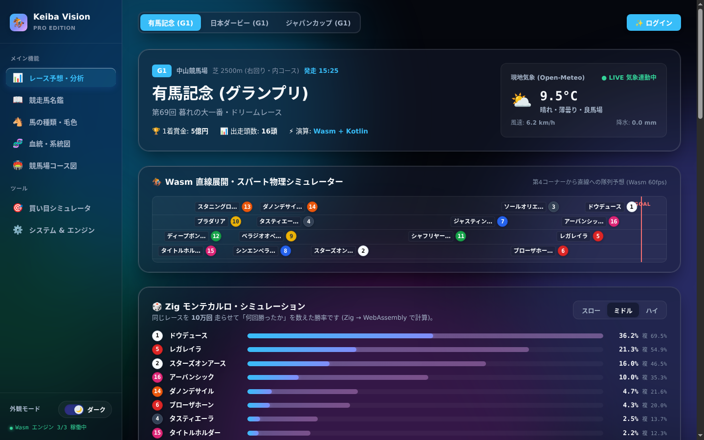
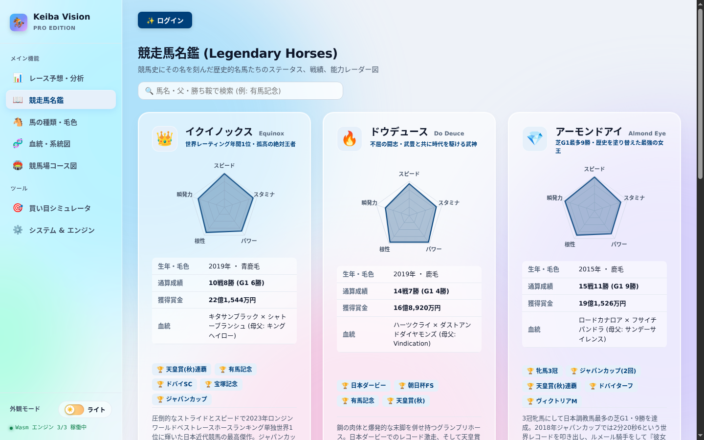
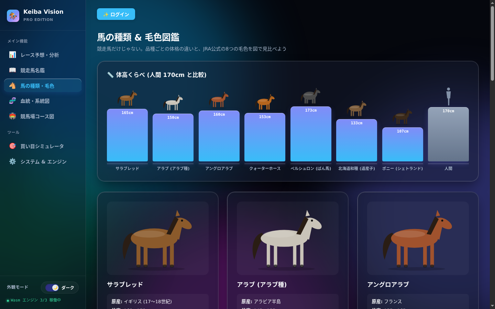
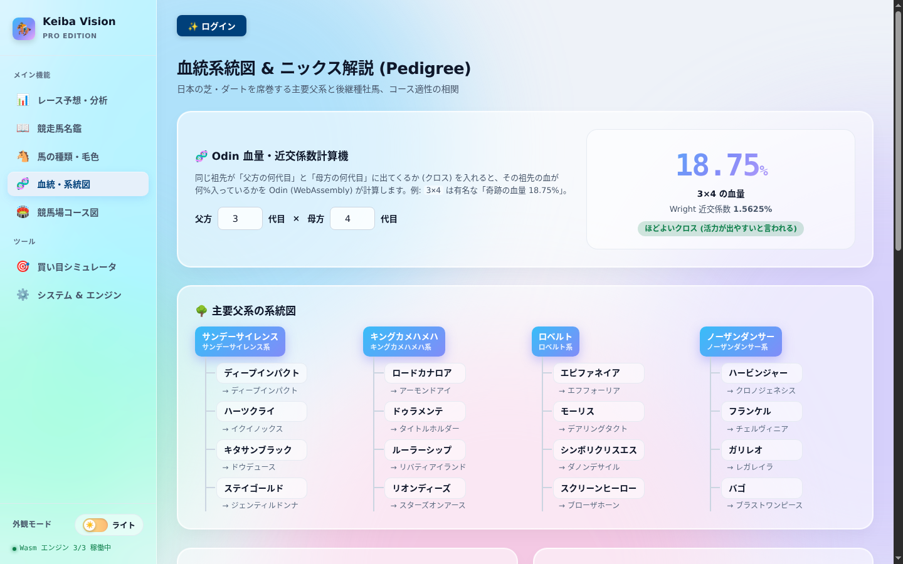
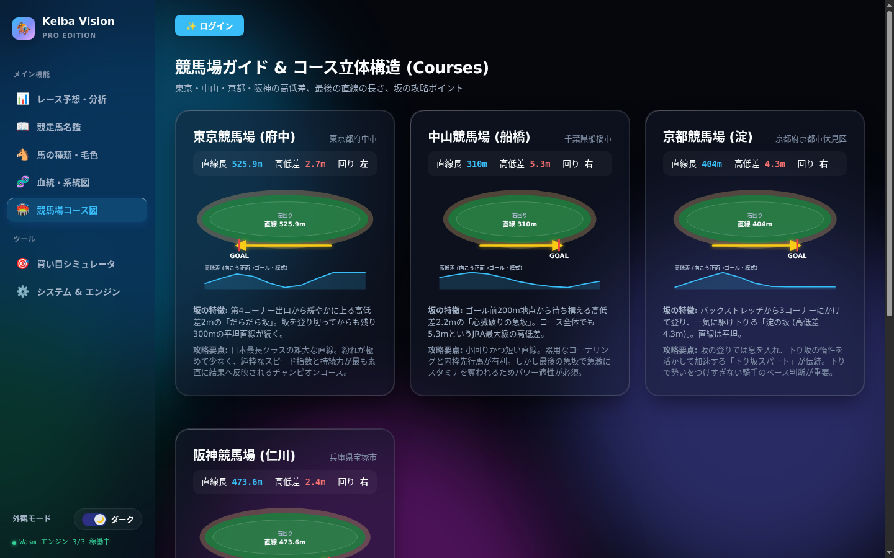
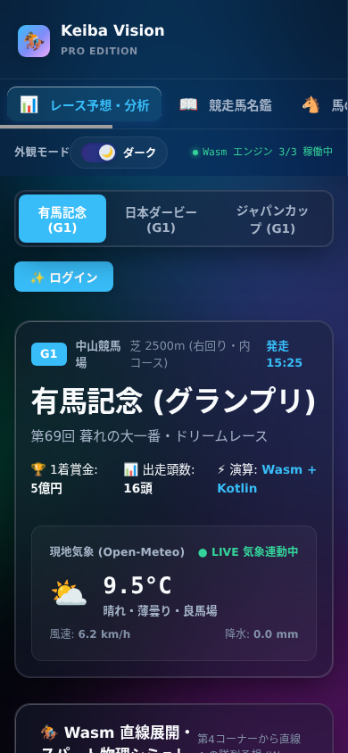
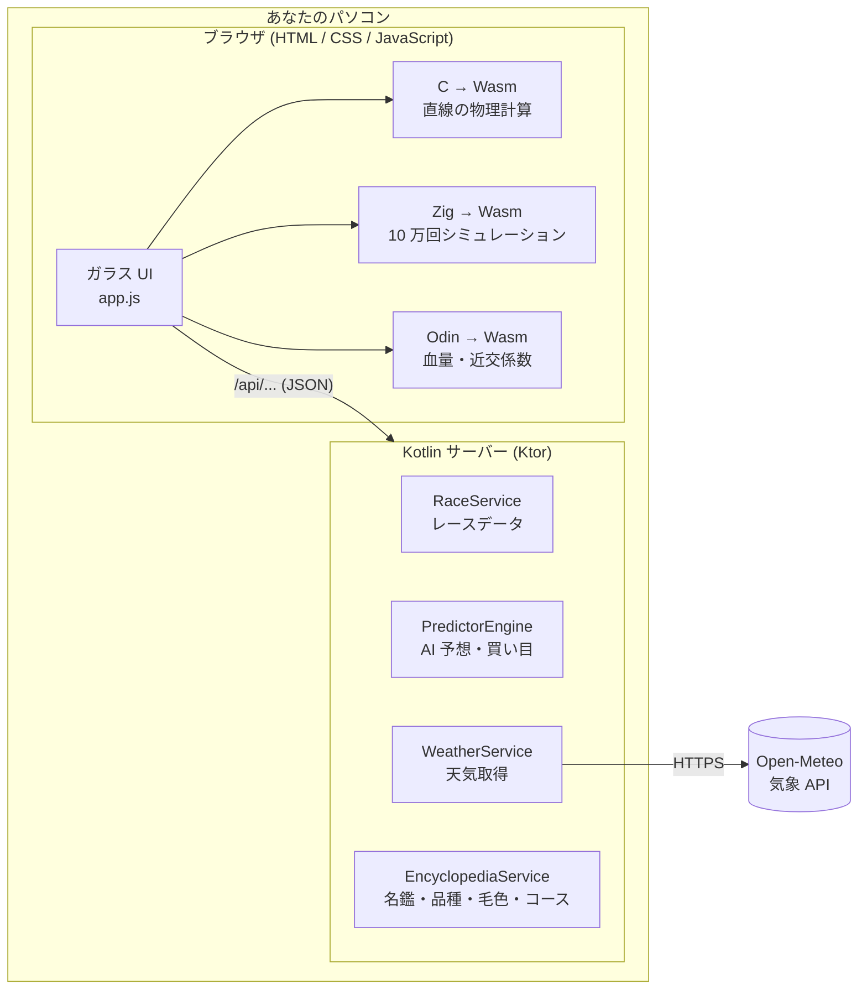

# 🏇 Keiba Vision — 競馬予想アプリ (Kotlin × Zig × Odin × WebAssembly)

Apple 製品のような **透明感のあるガラス (グラスモーフィズム) デザイン** の競馬予想アプリです。
メインは **Kotlin**。重い計算の一部を **Zig・Odin・C** で書いて **WebAssembly (Wasm)** に変換し、ブラウザの中で高速に動かしています。

- 🌗 **ダークモード / ライトモード** (OS の設定に自動で合わせる・手動切替もOK)
- ✨ **起動時のスプラッシュアニメーション** (光の筋 → 波紋 → 中央から円形に開いて本編へ)
- 📚 **左サイドメニュー** から 7 つの画面に切り替え
- 🐴 **競走馬名鑑・馬の種類・毛色図鑑・血統の系統図・競馬場コース図**
- 🎲 **Zig 製モンテカルロ** で同じレースを 10 万回走らせて勝率を計算
- 🧬 **Odin 製の血量計算機** (「奇跡の血量 3×4 = 18.75%」など)

> [!NOTE]
> このアプリの予想は **学習・娯楽用** です。レースデータはアプリに内蔵されたサンプルで、実際のオッズとは連動していません。馬券は 20 歳になってから、無理のない範囲で楽しみましょう。

---

## 📸 スクリーンショット

| 起動スプラッシュ | レース予想 (ダーク) |
|---|---|
|  |  |

| レース予想 (ライト) | 競走馬名鑑 (レーダー図) |
|---|---|
|  |  |

| 馬の種類・体高くらべ | 血統の系統図 & Odin 計算機 |
|---|---|
|  |  |

| 競馬場コース図 | スマホ表示 |
|---|---|
|  |  |

---

## 📖 目次

1. [まずは 3 分で動かす (いちばん簡単な方法)](#-まずは-3-分で動かす-いちばん簡単な方法)
2. [準備: Java を入れる (OS 別)](#-準備-java-を入れる-os-別)
3. [ソースコードから動かす](#-ソースコードから動かす)
4. [画面ごとの使い方](#-画面ごとの使い方)
5. [用語集 (競馬の言葉・プログラミングの言葉)](#-用語集)
6. [しくみ (どの言語が何をしているか)](#-しくみ-どの言語が何をしているか)
7. [フォルダ構成](#-フォルダ構成)
8. [API 一覧](#-api-一覧)
9. [Zig / Odin / C を自分でビルドする](#-zig--odin--c-を自分でビルドする)
10. [改造してみる (開発の流れ)](#-改造してみる-開発の流れ)
11. [GitHub Actions (自動ビルド & 自動リリース)](#-github-actions-自動ビルド--自動リリース)
12. [Cloudflare 版について](#-cloudflare-版について)
13. [困ったときは (トラブルシューティング)](#-困ったときは-トラブルシューティング)
14. [既知の制限](#-既知の制限)

---

## 🚀 まずは 3 分で動かす (いちばん簡単な方法)

プログラミングの知識がなくても、次の手順で動かせます。

1. **Java 21 を入れる** → [準備: Java を入れる](#-準備-java-を入れる-os-別) を見てください (すでに入っていればスキップ)。
2. このページ右側の **「Releases」** を開き、いちばん新しい版の **`keiba-predictor.zip`** をダウンロードします。
   - Releases がまだ無い場合は、このページ上部の緑色の **`<> Code` ボタン → `Download ZIP`** で全体をダウンロードし、[ソースコードから動かす](#-ソースコードから動かす) に進んでください。
3. ダウンロードした zip を **右クリック → 「すべて展開」** (Mac はダブルクリック) します。
4. 展開したフォルダの中の **`bin`** フォルダを開き、
   - **Windows**: `keiba-predictor.bat` を **ダブルクリック**
   - **Mac / Linux**: ターミナルで `./bin/keiba-predictor` を実行
5. 数秒待つと **ブラウザが自動で開いて** アプリが表示されます 🎉
   開かない場合は、ブラウザのアドレス欄に **`http://localhost:8080`** と入力してください。

**終わり方**: 黒い画面 (ターミナル / コマンドプロンプト) を閉じるか、その画面で `Ctrl` + `C` を押します。

> [!TIP]
> 「localhost (ローカルホスト)」は「自分のパソコン」という意味です。アプリは自分のパソコンの中で小さなサーバーとして動き、ブラウザはそこに接続して画面を表示します。インターネットに公開されるわけではありません。

---

## ☕ 準備: Java を入れる (OS 別)

このアプリは Kotlin で書かれていて、**Java 21 以上** (JVM と呼ばれる実行環境) の上で動きます。

### まず「もう入っているか」確認

ターミナル (Windows は「コマンドプロンプト」または「PowerShell」) を開いて、次を入力して Enter:

```sh
java -version
```

`openjdk version "21.x.x"` のように **21 以上** の数字が出れば準備完了です。
`'java' は、内部コマンドまたは外部コマンド…として認識されていません` や `command not found` が出たら、以下でインストールします。

<details>
<summary><b>🪟 Windows</b></summary>

1. <https://adoptium.net/ja/> を開く
2. 「Temurin 21 (LTS)」の **Windows 用 .msi** をダウンロード
3. ダブルクリックしてインストール。途中の画面で **「Set JAVA_HOME variable」と「Add to PATH」を有効** にする
4. **コマンドプロンプトを開き直して** `java -version` で確認

または PowerShell で: `winget install EclipseAdoptium.Temurin.21.JDK`
</details>

<details>
<summary><b>🍎 macOS</b></summary>

[Homebrew](https://brew.sh/ja/) が入っていれば:

```sh
brew install --cask temurin@21
```

入っていなければ <https://adoptium.net/ja/> から macOS 用の `.pkg` をダウンロードしてダブルクリックでインストールします。
</details>

<details>
<summary><b>🐧 Linux (Ubuntu / Debian / Arch / Fedora / Chimera)</b></summary>

```sh
# Ubuntu / Debian
sudo apt install openjdk-21-jdk

# Arch Linux
sudo pacman -S jdk21-openjdk

# Fedora
sudo dnf install java-21-openjdk

# Chimera Linux (musl)
doas apk add openjdk21
```
</details>

---

## 🛠 ソースコードから動かす

### 1. ダウンロード

**Git を使う場合** (おすすめ):

```sh
git clone https://github.com/TatsuyaM2667/keiba-predictor.git
cd keiba-predictor
```

**Git を使わない場合**: GitHub ページ上部の緑ボタン **`<> Code` → `Download ZIP`** → 展開 → そのフォルダでターミナルを開く。

> [!TIP]
> **「そのフォルダでターミナルを開く」方法**
> - Windows: エクスプローラーでフォルダを開き、上のアドレス欄に `cmd` と入力して Enter
> - Mac: Finder でフォルダを右クリック → 「フォルダに新規ターミナル」
> - Linux: ファイルマネージャーで右クリック → 「端末で開く」

### 2. 起動

| OS | やること |
|---|---|
| Windows | `run.bat` をダブルクリック (または `gradlew.bat run`) |
| Mac / Linux | ターミナルで `./run.sh` (または `./gradlew run`) |

**初回だけ 1〜3 分かかります。** 必要な部品 (Gradle というビルド道具と、Kotlin のライブラリ) をインターネットから自動でダウンロードするためです。2 回目以降は数秒で起動します。

次のような表示が出たら起動成功です。ブラウザが自動で開きます。

```
✅ Keiba Vision AI サーバーが起動しました！
👉 ブラウザで http://localhost:8080 を開いてください。
```

### 3. 便利な設定 (環境変数)

| 変数 | 意味 | 例 |
|---|---|---|
| `PORT` | 使うポート番号を変える (8080 がふさがっている時) | `PORT=9000 ./gradlew run` |
| `NO_BROWSER` | ブラウザを自動で開かない (サーバー用途・CI 用) | `NO_BROWSER=1 ./gradlew run` |

Windows (コマンドプロンプト) では `set PORT=9000` → `gradlew.bat run` のように 2 行に分けます。

---

## 🖥 画面ごとの使い方

左のサイドメニュー (スマホでは上部の横スクロールメニュー) から画面を切り替えます。
選んでいる項目には **ガラスのハイライトがぬるっと移動** します。

### 起動スプラッシュ
アプリを開くとまず表示されます。裏で次の 4 つを読み込み、終わるたびに ✓ が付きます。

- Kotlin API (サーバーとの通信)
- C Wasm 物理 / Zig モンテカルロ / Odin 血統計算 (3 つの WebAssembly エンジン)

全部そろうと中央のカードがズームアウトし、**画面中央から円形に穴が広がって** 本編が現れます。
急いでいるときは右下の **「スキップ」** か **`Esc` キー**。
OS の「視差効果を減らす / アニメーションを減らす」設定が ON の場合は、目にやさしい短いフェードだけになります。

### 🌗 ダーク / ライトの切り替え
サイドメニュー下の **「外観モード」スイッチ** を押します。対応ブラウザ (Chrome / Edge / Safari 18 以降など) では、**押した位置から新しい色が円形に広がる** アニメーションで切り替わります。
- 一度も押していないうちは **OS の設定 (ダーク / ライト) に自動で合わせます**。
- 一度押すとその選択を記憶し、次回もその色で起動します。

### 📊 レース予想・分析
上のタブで **有馬記念 / 日本ダービー / ジャパンカップ** を切り替えます。

| パネル | 何がわかるか |
|---|---|
| レース情報 & 現地気象 | 競馬場の **今の天気** を [Open-Meteo](https://open-meteo.com/) (無料・登録不要の気象 API) から取得し、雨量から馬場状態 (良・稍重・重・不良) を推定 |
| Wasm 直線展開シミュレーター | **C で書いた物理計算** で各馬の「最後の直線でどこまで伸びるか」を計算し、4 コーナーから一斉にスパートするアニメーションで表示。マウスを乗せると詳細 |
| Zig モンテカルロ | **同じレースを 10 万回走らせて** 何回勝ったかを数えた勝率 (濃い棒) と 3 着以内率 (薄い棒)。右上で想定ペース (スロー / ミドル / ハイ) を変えると、逃げ馬・追込馬の有利不利が変わります |
| 注目推奨馬 | Kotlin の予想エンジンによる印 (◎◯▲△☆) と総合指数 |
| 推奨買い目・資金配分 | 券種ごとのおすすめと、予算の何%を使うかの目安 |
| 出馬表 | 並び替え (馬番 / 総合指数 / 人気 / 期待値)。★ でお気に入り登録 (要ログイン) |

### 📖 競走馬名鑑
歴史的名馬のプロフィール。**5 角形のレーダー図** でスピード・スタミナ・パワー・根性・瞬発力を比較できます。上の検索欄で **馬名・父・勝ち鞍** を絞り込めます (例: `有馬記念`、`ディープ`)。

### 🐴 馬の種類・毛色
- **体高くらべ**: サラブレッド・アラブ・ばんえい馬・道産子・ポニーなどの **体高 (肩までの高さ)** を、人間 (170cm) と並べた棒グラフで比較
- **品種カード**: 体格の違いを図で表現 (ばんえい馬は太く、アラブは細く)
- **JRA 公式 8 毛色**: 栗毛・栃栗毛・鹿毛・黒鹿毛・青鹿毛・青毛・芦毛・白毛 を、**体の色とたてがみの色** の図で見比べ

### 🧬 血統・系統図
- **Odin 血量・近交係数計算機**: 「父方の何代目」と「母方の何代目」に同じ祖先がいるかを入れると、その祖先の **血量 (%)** と **Wright の近交係数** を Odin が計算。結果は「弱い / ほどよい / 濃い」の 3 段階で評価
- **系統図**: 始祖 → 代表種牡馬 → 代表産駒 のツリー
- **系統カード**: 芝・ダート適性、得意距離、特徴

### 🏟 競馬場コース図
東京・中山・京都・阪神の **コースの形 (右回り/左回り・直線の長さ) と高低差のグラフ** を SVG (拡大してもぼやけない図) で表示します。黄色い矢印が最後の直線、赤い線がゴールです。
※ 高低差グラフは特徴をつかむための **模式図** で、正確な測量データではありません。

### 🎯 買い目シミュレータ
オッズと購入金額を入れると、当たったときの払戻金と回収率をその場で計算します。

### ⚙️ システム & エンジン
3 つの WebAssembly エンジンが **実際に読み込めたか** をリアルタイムで表示します。

### 🔐 ログイン (デモ)
右上の「ログイン」から **1 クリックデモログイン** ができ、★お気に入り と 📝予想メモ が使えるようになります。
> [!IMPORTANT]
> 現在は **GitHub / Google ボタンもデモ用のログイン** です (本物のアカウント連携はしていません)。データはサーバーのメモリ上にだけ保存され、**アプリを終了すると消えます**。

---

## 📚 用語集

<details open>
<summary><b>競馬の言葉</b></summary>

| 言葉 | 意味 |
|---|---|
| G1 (ジーワン) | 最も格の高いレース。有馬記念・日本ダービー・ジャパンカップなど |
| 枠 / 馬番 | スタート位置のグループ (1〜8 枠、色付き) と、馬ごとの番号 |
| オッズ | 当たったときに賭け金が何倍になるか。低いほど人気 |
| 単勝 / 複勝 | 1 着を当てる / 3 着以内 (頭数が少ないと 2 着以内) を当てる |
| 馬連 / ワイド | 1・2 着の 2 頭を当てる (順不同) / 3 着以内の 2 頭を当てる |
| 3 連複 / 3 連単 | 1〜3 着の 3 頭を順不同で / 着順どおりに当てる |
| 脚質 | 走り方のタイプ。**逃げ** (先頭を走る) / **先行** (前の方) / **差し** (中団から伸びる) / **追込** (後方から一気) |
| ペース | レース前半の速さ。ハイペースだと前の馬が疲れて差し・追込が有利、スローだと逃げ・先行が有利 |
| 馬場状態 | 地面のコンディション。良 → 稍重 → 重 → 不良 の順に水を含んで走りにくくなる |
| スピード指数 | 過去の走破タイムから馬の能力を数値化したもの (このアプリでは 100〜120 程度) |
| 体高 (たいこう) | 地面から **肩 (き甲)** までの高さ。頭までではない |
| 毛色 | 馬の体の色。JRA では 8 種類に分類 |
| 血統 / 父系 | 親子関係。父→父→父…とたどった系統を「〇〇系」と呼ぶ |
| クロス / インブリード | 同じ祖先が父方・母方の両方に出てくること。「3×4」= 父方 3 代目と母方 4 代目 |
| 血量 | その祖先の血が何%入っているか。3×4 は 12.5% + 6.25% = **18.75% (奇跡の血量)** |
| 近交係数 | 両親が血縁関係にある度合い。Wright の式 F = (1/2)^(n1+n2+1) で計算 |
| 回収率 | 払戻金 ÷ 賭け金 × 100。100% を超えれば黒字 |
</details>

<details open>
<summary><b>プログラミングの言葉</b></summary>

| 言葉 | 意味 |
|---|---|
| Kotlin (コトリン) | このアプリのメイン言語。Android アプリでも使われる、読みやすく安全な言語 |
| JVM / Java | Kotlin のプログラムを動かすための土台 (実行環境) |
| Gradle (グレイドル) | Kotlin プログラムを組み立てて (ビルドして) 実行する道具。`./gradlew` で自動ダウンロードされる |
| Ktor (ケイター) | Kotlin でサーバーを作るためのライブラリ |
| サーバー / API | データを返す係。ブラウザが「有馬記念のデータちょうだい」と頼むと JSON で返す |
| JSON | `{"name": "ドウデュース"}` のような、プログラム同士がデータをやり取りする書式 |
| WebAssembly (Wasm) | ブラウザの中で C・Zig・Odin などのプログラムを **ほぼネイティブ速度** で動かす仕組み |
| Zig (ジグ) | C の後継を目指す高速な言語。このアプリでは 10 万回のレースシミュレーションを担当 |
| Odin (オーディン) | ゲーム開発などで使われるシンプルで高速な言語。血量計算を担当 |
| C | 古くからある高速な言語。直線の物理計算を担当 |
| モンテカルロ法 | 乱数でたくさん試して確率を求める方法。「10 万回走らせて 3 万回勝ったら勝率 30%」 |
| グラスモーフィズム | すりガラスのように **背景がぼけて透けて見える** デザイン。CSS の `backdrop-filter: blur()` で実現 |
| SVG | 拡大してもぼやけない図の形式。レーダー図・コース図・馬のイラストに使用 |
| localhost:8080 | 自分のパソコンの 8080 番の窓口。アプリのサーバーがここで待っている |
| CI / GitHub Actions | GitHub に push するたびに自動でビルド・テストしてくれる仕組み |
</details>

---

## 🧠 しくみ (どの言語が何をしているか)



### なぜ言語を分けているの？

| 担当 | 言語 | 理由 |
|---|---|---|
| サーバー・データ・予想ロジック・名鑑データ | **Kotlin** | 型が安全で読みやすく、ライブラリが豊富。アプリの「本体」 |
| 10 万回のレースシミュレーション | **Zig** | 同じ計算を大量に繰り返すので速さが重要。Zig は小さく速い Wasm を作れる (約 1KB) |
| 血量・近交係数の計算 | **Odin** | 数式をシンプルに書け、Wasm に直接出力できる (約 0.8KB) |
| 直線の伸び (物理計算) | **C** | もっとも基本的な Wasm の作り方の見本 (約 0.7KB) |
| 画面・アニメーション | **HTML / CSS / JavaScript** | ブラウザで動かすための標準技術 |

Zig・Odin・C のコードは **ブラウザ内で** 動くので、サーバーに負担をかけず、通信待ちもありません。
**ビルド済みの `.wasm` ファイルを同梱している** ので、Zig や Odin をインストールしなくてもアプリは動きます。

### Zig モンテカルロのしくみ (かんたん版)

1 回のレースで、各馬の「その日の出来」を次のように決めます:

```
出来 = (スピード指数 ÷ 100) × 脚質とペースの相性 × 調教の仕上がり + ランダムな揺らぎ
```

一番「出来」が良かった馬が 1 着。これを 10 万回くり返して、1 着になった割合を勝率とします。揺らぎの大きさは「実データで 1 番人気の勝率が 3〜4 割になる」ように調整してあり、`zig test` で「強い馬ほど勝ちやすい」「勝率の合計が 100%」になることを自動テストしています。

---

## 📁 フォルダ構成

```text
keiba-predictor/
├── README.md                  ← このファイル
├── build.gradle.kts           ← Kotlin のビルド設定 (使うライブラリの一覧)
├── gradlew / gradlew.bat      ← Gradle を自動ダウンロードして実行するスクリプト
├── run.sh / run.bat / run.ps1 ← かんたん起動スクリプト (Linux・Mac / Windows)
├── keiba-vision.desktop       ← Linux のアプリメニュー登録用
├── .github/workflows/ci.yml   ← GitHub Actions (自動ビルド・テスト・リリース)
├── docs/screenshots/          ← README の画像
├── native/                    ← Kotlin 以外の高速計算コード
│   ├── build.sh               ← C / Zig / Odin → .wasm にまとめてビルド
│   ├── wasm/keiba_physics.c   ← C: 直線の伸びの物理計算
│   ├── zig/montecarlo.zig     ← Zig: 10 万回レースシミュレーション (+ テスト)
│   └── odin/pedigree.odin     ← Odin: 血量・近交係数
├── cloudflare/                ← Cloudflare Workers 版 (実験的)
└── src/main/
    ├── kotlin/com/example/keiba/
    │   ├── Main.kt                    ← サーバー起動・URL ごとの処理・ブラウザ自動起動
    │   ├── model/Models.kt            ← データの形 (馬・レース・品種・毛色など)
    │   └── service/
    │       ├── RaceService.kt         ← レースと出走馬のデータ
    │       ├── PredictorEngine.kt     ← 予想・印・買い目の計算
    │       ├── WeatherService.kt      ← Open-Meteo から天気を取得
    │       ├── EncyclopediaService.kt ← 名鑑・血統・コース・品種・毛色のデータ
    │       └── AuthService.kt         ← デモログイン・お気に入り・メモ
    └── resources/static/
        ├── index.html         ← 画面の骨組み (スプラッシュ・サイドメニュー・各画面)
        ├── style.css          ← デザイン (ガラス・ダーク/ライト・アニメーション)
        ├── app.js             ← 画面の動き・図の描画・Wasm の呼び出し
        └── wasm/              ← ビルド済み WebAssembly (C / Zig / Odin)
```

---

## 🔌 API 一覧

サーバー起動中にブラウザで開くと、生データ (JSON) を見られます。

| URL | 中身 |
|---|---|
| `/api/health` | サーバーが動いているか |
| `/api/races` | レース一覧 |
| `/api/races/{id}/analysis` | 予想・買い目・展開 (id は `arima-2026` / `derby-2026` / `jc-2026`) |
| `/api/encyclopedia/horses` | 名馬名鑑 |
| `/api/encyclopedia/pedigree` | 血統 (父系) |
| `/api/encyclopedia/courses` | 競馬場 (直線・高低差・回り・高低差プロファイル) |
| `/api/encyclopedia/breeds` | 馬の品種 |
| `/api/encyclopedia/coats` | JRA 公式 8 毛色 |
| `/api/native/info` | 同梱されている `.wasm` のサイズ (バイト) |
| `POST /api/auth/login?provider=demo` | デモログイン |
| `POST /api/favorites` / `POST /api/notes` | お気に入り / 予想メモ (要ログイン) |

例: <http://localhost:8080/api/encyclopedia/coats>

---

## 🔧 Zig / Odin / C を自分でビルドする

`.wasm` は同梱済みなので **普段は不要** です。`native/` のコードを書き換えたときだけ行います。

### 必要なツール
| 言語 | ツール | 入手先 |
|---|---|---|
| C | `clang` と `wasm-ld` (LLVM) | Linux: `apt install clang lld` / Mac: `brew install llvm` |
| Zig | `zig` 0.15 以降 (0.17.1 で動作確認) | <https://ziglang.org/download/> (展開して PATH に追加するだけ) |
| Odin | `odin` (dev-2025 以降、dev-2026-11 で動作確認) | <https://github.com/odin-lang/Odin/releases> |

### 実行
```sh
./native/build.sh
```
- 入っているツールの分だけビルドされます (無いものは自動でスキップ)
- Zig は **ビルド前に自動テスト** (`zig test`) を実行し、失敗したら止まります
- 出力先: `src/main/resources/static/wasm/`
- その後、アプリを再起動すると新しい `.wasm` が使われます

---

## ✏️ 改造してみる (開発の流れ)

1. エディタ (おすすめ: [IntelliJ IDEA Community](https://www.jetbrains.com/ja-jp/idea/download/) か [VS Code](https://code.visualstudio.com/)) でフォルダを開く
2. ファイルを編集
3. ターミナルで `Ctrl` + `C` でアプリを止め、もう一度 `./gradlew run`
4. ブラウザを再読み込み (`F5`、Mac は `Cmd` + `R`)

**改造の例**
- 名鑑に馬を追加 → `EncyclopediaService.kt` の `getLegendaryHorses()` に `LegendaryHorse(...)` を 1 つ足す
- 色を変える → `style.css` 冒頭の `:root { ... }` (ライト) と `[data-theme="dark"] { ... }` (ダーク) の色を変える
- 勝率シミュレーションの回数を変える → `app.js` の `const ITER = 100000;`

---

## 🤖 GitHub Actions (自動ビルド & 自動リリース)

`.github/workflows/ci.yml` により、GitHub に push するたびに自動で:

1. Zig のテストを実行
2. Kotlin をビルドし、配布用 zip を作成
3. 実際にサーバーを起動して API と `.wasm` が正しく返るか確認

さらに **`v` で始まるタグ** を push すると、配布用 zip が **Releases に自動公開** されます:

```sh
git tag v1.0.0
git push origin v1.0.0
```

結果はリポジトリの **「Actions」タブ** で確認できます。

---

## ☁️ Cloudflare 版について

`cloudflare/` には Cloudflare Workers + D1 + KV で動かす実験的なバックエンドがあります。手順は [cloudflare/README.md](cloudflare/README.md) を参照してください。
※ Workers 版はまだ **レース・ログイン系の API のみ** で、名鑑・品種・毛色・コースの API は未実装です (Kotlin 版のみ対応)。

---

## 🆘 困ったときは (トラブルシューティング)

<details>
<summary><b>「java が見つかりません」「'java' は認識されていません」</b></summary>

Java が入っていないか、PATH (コマンドの置き場所の登録) が通っていません。[Java を入れる](#-準備-java-を入れる-os-別) を行い、**ターミナルを開き直して** から `java -version` を確認してください。
</details>

<details>
<summary><b>「Address already in use」「ポート 8080 は使用中」</b></summary>

別のアプリ (または前回起動したこのアプリ) が 8080 番を使っています。前のターミナルを閉じるか、別の番号で起動します: `PORT=9000 ./gradlew run` → <http://localhost:9000>
</details>

<details>
<summary><b>ブラウザが自動で開かない</b></summary>

自分でブラウザを開き、アドレス欄に `http://localhost:8080` と入力してください。Linux では `xdg-open` が無い環境で起こります。
</details>

<details>
<summary><b>スプラッシュの後、画面が真っ白 / 何も表示されない</b></summary>

- ブラウザで `F12` → 「Console (コンソール)」タブに赤いエラーが出ていないか確認
- ブラウザが古いと動かない部分があります。Chrome / Edge / Firefox / Safari の最新版を使ってください
- サーバー側のターミナルにエラーが出ていないか確認
</details>

<details>
<summary><b>「Wasm エンジン 2/3 稼働中」など、一部のエンジンが読めない</b></summary>

「⚙️ システム & エンジン」画面で、どれが失敗したか確認できます。`src/main/resources/static/wasm/` に `keiba_physics.wasm` / `montecarlo.wasm` / `pedigree.wasm` の 3 つがあるか確認し、無ければ `./native/build.sh` で作り直してください。読めないエンジンの部分だけ表示が省略され、他の機能は動きます。
</details>

<details>
<summary><b>天気が「推定気象データ」になる</b></summary>

インターネットに繋がっていないか、Open-Meteo に接続できない状態です。アプリは推定値で動き続けます。
</details>

<details>
<summary><b>初回の起動がとても遅い / 止まって見える</b></summary>

初回は Gradle とライブラリ (数百 MB) をダウンロードしています。回線によっては数分かかります。2 回目以降は速くなります。
</details>

<details>
<summary><b>アニメーションを止めたい</b></summary>

OS の設定で「アニメーションを減らす」(Windows: 設定 → アクセシビリティ → 視覚効果 → アニメーション効果 / Mac: システム設定 → アクセシビリティ → ディスプレイ → 視差効果を減らす) を ON にすると、アプリのアニメーションも最小限になります。
</details>

<details>
<summary><b>Chimera Linux (musl) で動く？</b></summary>

動きます。UI はブラウザで表示するため、glibc 前提のネイティブ GUI ライブラリを使っていません。`doas apk add openjdk21` の後 `./run.sh` で起動できます。
</details>

---

## ⚠️ 既知の制限

- レース・出走馬・オッズは **アプリ内蔵のサンプルデータ** です (実際の出馬表とは連動していません)
- ログインは **デモのみ**。お気に入り・メモはアプリ終了で消えます
- コースの高低差グラフは **模式図** です
- テーマ切替の円形アニメーションは View Transitions API 対応ブラウザのみ (非対応ブラウザでは瞬時に切り替わります)
