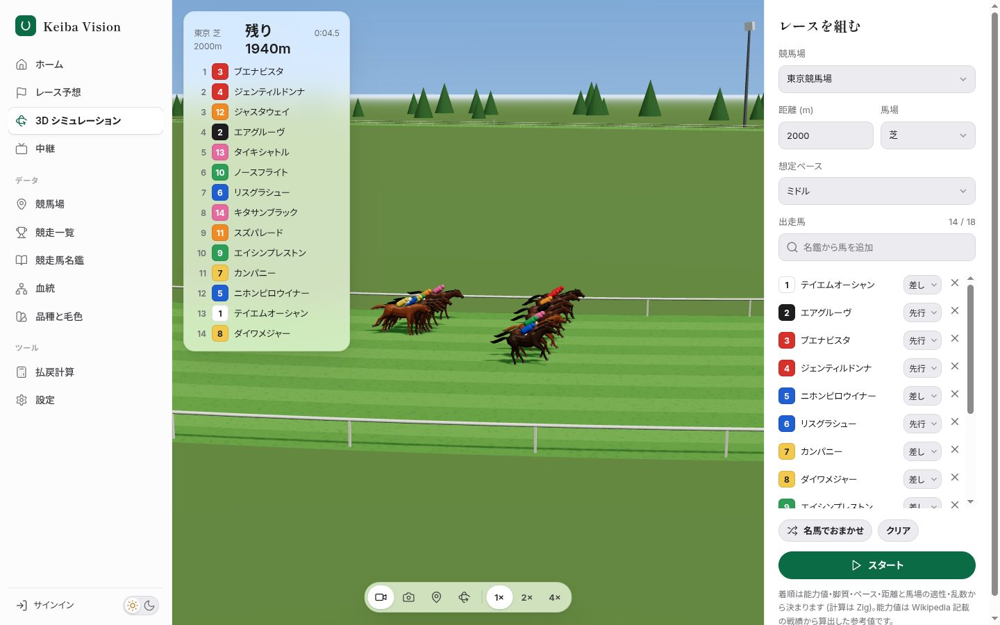
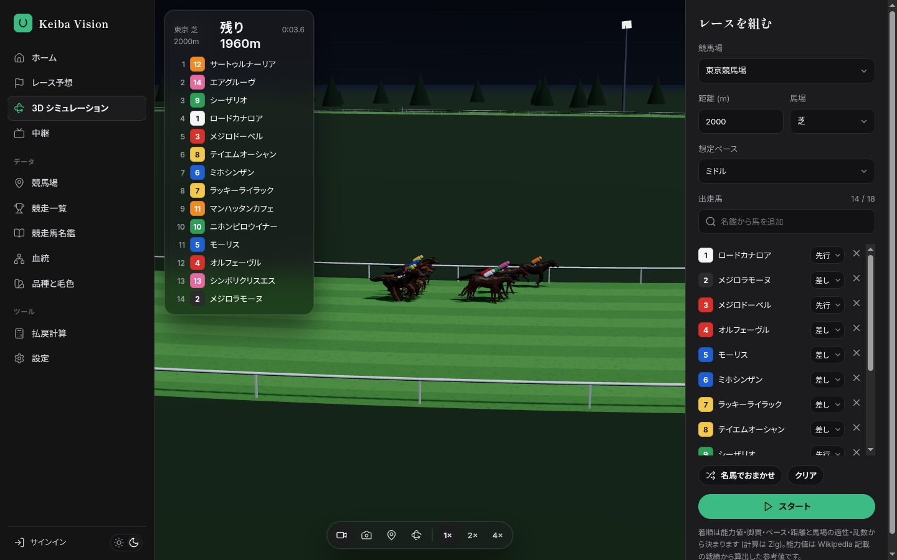
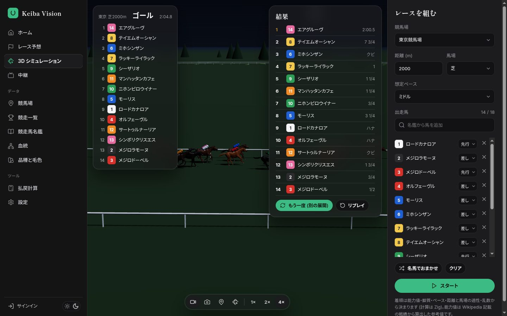
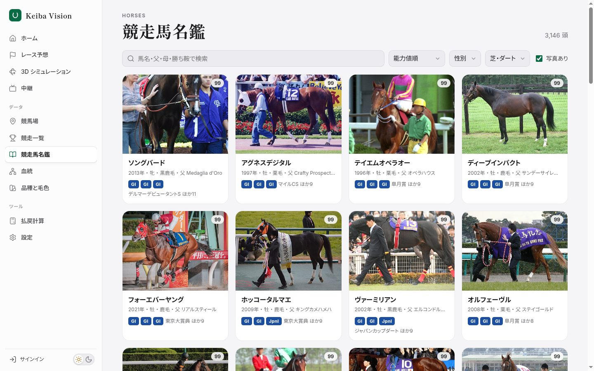
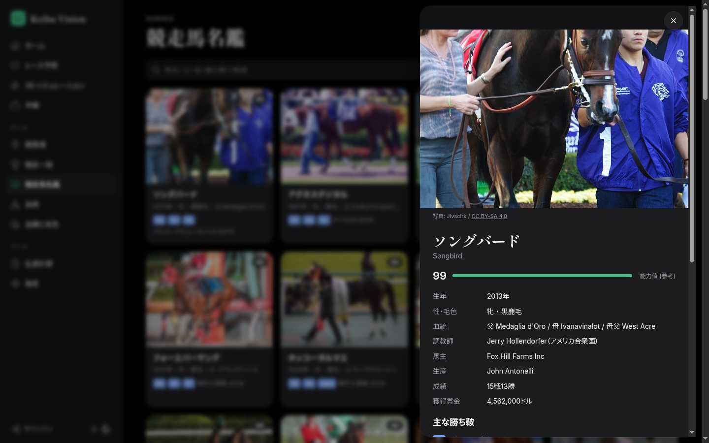
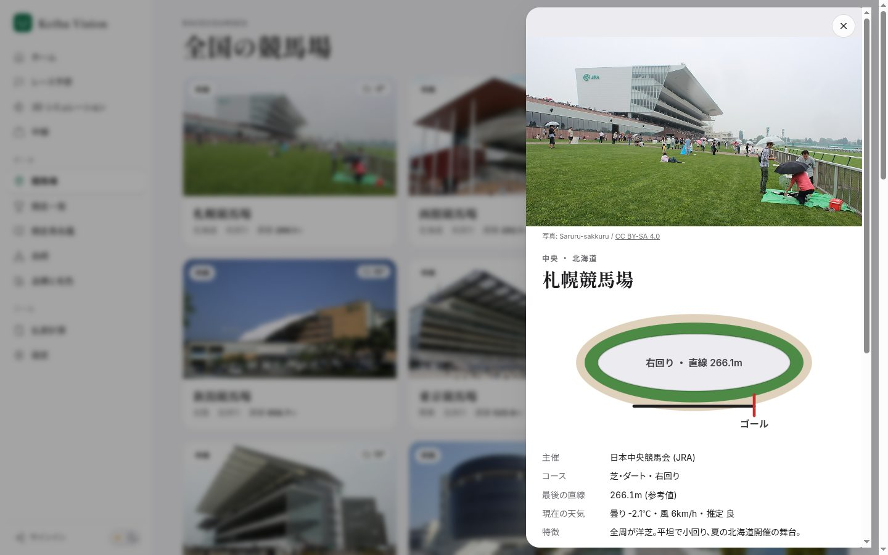
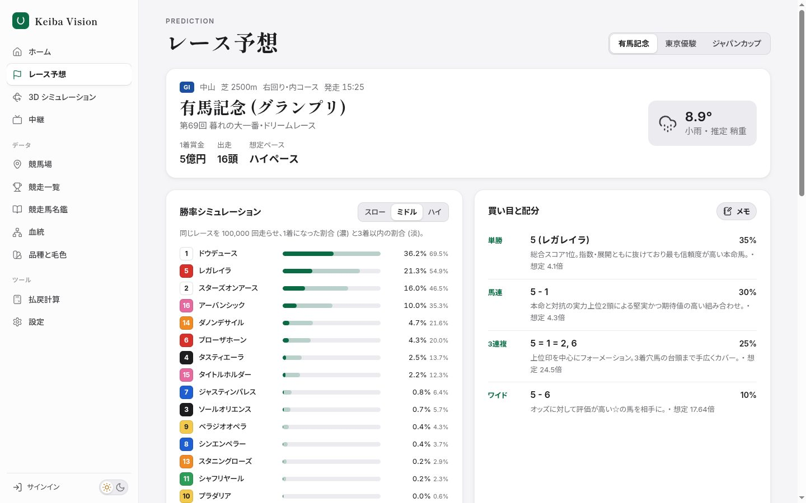
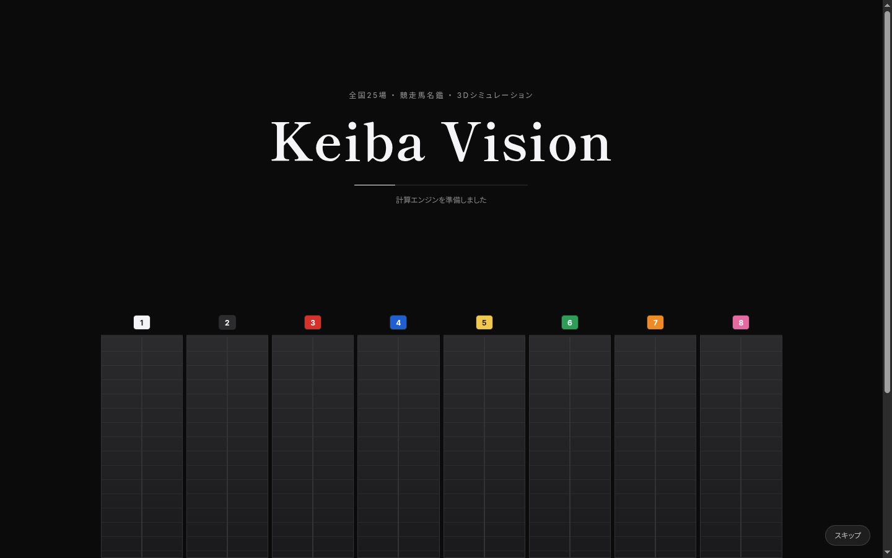
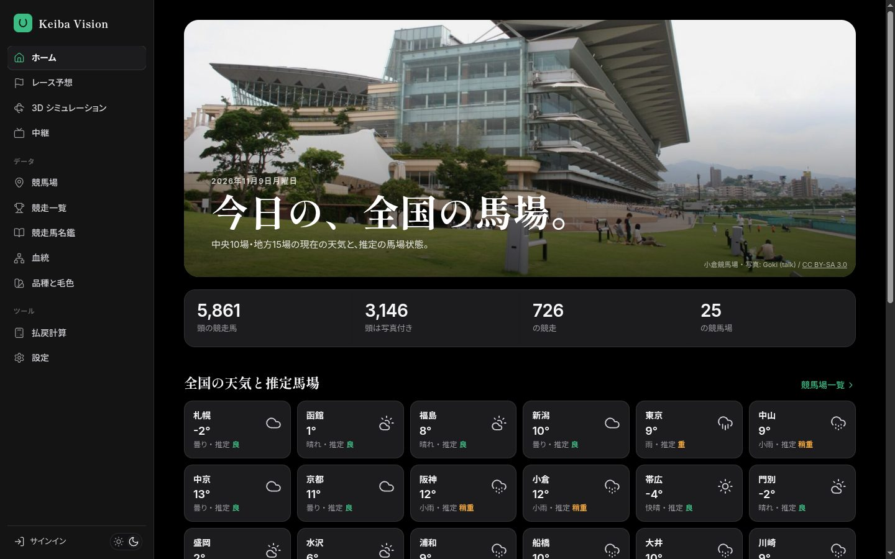
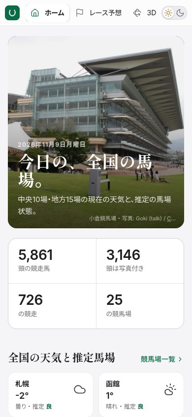

# Keiba Vision

全国25の競馬場、5,800頭を超える競走馬の名鑑、3Dのレースシミュレーション、各競馬場の公式中継をひとつにまとめた競馬アプリです。
本体は **Kotlin** で、重い計算の一部を **Zig・Odin・C** で書いて **WebAssembly** に変換し、ブラウザの中で動かしています。

**Web 版 (インストール不要): https://keiba-vision.pages.dev**

**ドキュメント (予想と推論の数学を、初心者から専門家レベルまで): https://keiba-vision-docs.pages.dev**


> [!NOTE]
> 予想とシミュレーションは娯楽・学習のためのものです。馬券の購入は20歳以上、無理のない範囲で楽しみましょう。

---

## できること

| 画面 | 内容 |
|---|---|
| ホーム | 全国25場の **今の天気と推定の馬場状態**、登録データの件数、名馬のピックアップ |
| レース予想 | **JRA の今週の全レース** を自動で取り込み、出馬表・オッズ・印・買い目 (期待値とケリー基準)、同じレースを **10万回走らせた勝率**。これからの開催 (10週間) の予定表も |
| 3D シミュレーション | 好きな競馬場・距離・馬場で、名鑑の馬を最大18頭選んで **3Dで走らせる**。中継・追走・俯瞰・自由視点の4カメラ、等速/2倍/4倍、着差 (ハナ・クビ・1 1/4 …) つきの結果表 |
| 中継 | 各競馬場の **公式 YouTube チャンネル** を埋め込み再生 (ライブ / 最新の映像) |
| 競馬場 | 中央10場・地方14場・ばんえい1場。写真、コース図、直線の長さ、回り、現在の天気、その場で行われる主な競走 |
| 競走一覧 | 国内の **726競走** を格付け (GI〜GIII・JpnI〜III ほか)・競馬場・芝/ダートで絞り込み |
| 競走馬名鑑 | **5,861頭** (うち写真付き 3,146頭)。名前・父・母・勝ち鞍で検索、能力値・重賞勝利数・年代で並び替え。詳細画面に写真 (作者とライセンス表示つき)、血統、成績、獲得賞金、主な勝ち鞍、Wikipedia の要約 |
| 血統 | 主な父系の系統図と、**血量・近交係数の計算機** (3×4 = 18.75% など) |
| 品種と毛色 | 品種ごとの体高くらべ、JRA の8つの毛色の図 |
| 払戻計算 | オッズと金額から払戻金と回収率 |
| 設定 | ライト / ダーク / 自動、データの更新、計算エンジンの状態、データとライセンスの一覧 |

| 3D シミュレーション (昼) | 3D シミュレーション (ナイター) |
|---|---|
|  |  |

| 結果と着差 | 競走馬名鑑 |
|---|---|
|  |  |

| 馬の詳細 (ダーク) | 競馬場の詳細 |
|---|---|
|  |  |

| 中継 | レース予想 |
|---|---|
|  |  |

| 起動画面 (発馬ゲートが開いて本編へ) | ホーム (ダーク) | スマホ |
|---|---|---|
|  |  |  |

---

## 目次

1. [まず動かす (いちばん簡単な方法)](#まず動かす-いちばん簡単な方法)
2. [Java を入れる (OS 別)](#java-を入れる-os-別)
3. [ソースコードから動かす](#ソースコードから動かす)
4. [画面ごとの使い方](#画面ごとの使い方)
5. [データはどこから来ているか](#データはどこから来ているか)
6. [用語集](#用語集)
7. [しくみ](#しくみ)
8. [フォルダ構成](#フォルダ構成)
9. [API 一覧](#api-一覧)
10. [Zig / Odin / C を自分でビルドする](#zig--odin--c-を自分でビルドする)
11. [改造してみる](#改造してみる)
12. [GitHub Actions](#github-actions)
13. [困ったときは](#困ったときは)
14. [できないこと・既知の制限](#できないこと既知の制限)
15. [ライセンスとクレジット](#ライセンスとクレジット)

---

## まず動かす (いちばん簡単な方法)

1. **Java 21 を入れる** ([次の章](#java-を入れる-os-別)。入っていれば不要)
2. このリポジトリの右側にある **Releases** を開き、いちばん新しい版の **`keiba-predictor.zip`** をダウンロード
3. zip を展開 (Windows は右クリック →「すべて展開」、Mac はダブルクリック)
4. 展開したフォルダの中の **`bin`** を開いて起動
   - **Windows**: `keiba-predictor.bat` をダブルクリック
   - **Mac / Linux**: ターミナルで `./bin/keiba-predictor`
5. 数秒でブラウザが開きます。開かないときはアドレス欄に **`http://localhost:8080`** と入力

**終わり方**: 起動した黒い画面 (ターミナル) を閉じるか、その画面で `Ctrl` + `C`。

> [!TIP]
> `localhost` は「自分のパソコン」という意味です。アプリは自分のパソコンの中で小さなサーバーとして動き、ブラウザがそこに接続します。外部に公開されることはありません。

**インターネット接続について**: 名鑑・競走・競馬場のデータはアプリに同梱されているので、オフラインでも見られます。天気・写真・中継・Wikipedia の要約はインターネットが必要です。

---

## Java を入れる (OS 別)

このアプリは Kotlin で書かれていて、**Java 21 以上** の上で動きます。

### 入っているか確認

ターミナル (Windows は「コマンドプロンプト」か「PowerShell」) で次を入力して Enter:

```sh
java -version
```

`openjdk version "21.x.x"` のように **21 以上** が出れば準備完了です。`java は認識されていません` や `command not found` が出たら、以下で入れます。

<details>
<summary><b>Windows</b></summary>

1. <https://adoptium.net/ja/> を開く
2. 「Temurin 21 (LTS)」の Windows 用 `.msi` をダウンロード
3. インストール中の画面で **「Set JAVA_HOME variable」「Add to PATH」を有効** にする
4. コマンドプロンプトを **開き直して** `java -version` で確認

PowerShell なら `winget install EclipseAdoptium.Temurin.21.JDK` でも入ります。
</details>

<details>
<summary><b>macOS</b></summary>

[Homebrew](https://brew.sh/ja/) があれば `brew install --cask temurin@21`。
なければ <https://adoptium.net/ja/> から macOS 用の `.pkg` を入れます。
</details>

<details>
<summary><b>Linux</b></summary>

```sh
sudo apt install openjdk-21-jdk     # Ubuntu / Debian
sudo pacman -S jdk21-openjdk        # Arch Linux
sudo dnf install java-21-openjdk    # Fedora
doas apk add openjdk21              # Chimera Linux (musl)
```
</details>

---

## ソースコードから動かす

### 1. ダウンロード

```sh
git clone https://github.com/TatsuyaM2667/keiba-predictor.git
cd keiba-predictor
```

Git がなければ、GitHub のページ上部の緑のボタン **`<> Code` → `Download ZIP`** で落として展開し、そのフォルダでターミナルを開きます。

> [!TIP]
> **フォルダでターミナルを開く方法**
> - Windows: エクスプローラーのアドレス欄に `cmd` と入力して Enter
> - Mac: Finder でフォルダを右クリック →「フォルダに新規ターミナル」
> - Linux: ファイルマネージャーで右クリック →「端末で開く」

### 2. 起動

| OS | コマンド |
|---|---|
| Windows | `run.bat` をダブルクリック (または `gradlew.bat run`) |
| Mac / Linux | `./run.sh` (または `./gradlew run`) |

**初回だけ 1〜3 分** かかります (ビルド道具の Gradle とライブラリを自動でダウンロードするため)。2回目からは数秒です。

### 3. 便利な設定 (環境変数)

| 変数 | 意味 | 例 |
|---|---|---|
| `PORT` | 使うポート番号 (8080 が使用中のとき) | `PORT=9000 ./gradlew run` |
| `NO_BROWSER` | ブラウザを自動で開かない | `NO_BROWSER=1 ./gradlew run` |

Windows のコマンドプロンプトでは `set PORT=9000` と `gradlew.bat run` を2行に分けて入力します。

---

## 画面ごとの使い方

左のメニュー (スマホでは上の横スクロールメニュー) で画面を切り替えます。URL は `http://localhost:8080/#/horses` のように画面ごとに変わるので、ブックマークもできます。

### 起動画面
8つの枠の発馬ゲートが並び、読み込みが終わるとゲートが開いて本編に切り替わります。右下の「スキップ」か `Esc` キーで飛ばせます。OS で「視差効果を減らす / アニメーションを減らす」を有効にしている場合は、動きを最小限にします。

### ライト / ダーク
左下のスイッチで切り替えます。設定画面で「自動」を選ぶと OS の設定に合わせます。3D シミュレーションはダークのとき **ナイター** (夜の照明) で描かれます。

### ホーム
全国25場の現在の天気 ([Open-Meteo](https://open-meteo.com/)) と、降水量から推定した馬場状態 (良・稍重・重・不良) を表示します。カードを押すとその競馬場の詳細が開きます。推定馬場は公式発表ではありません。

### レース予想
JRA (中央競馬) の今週のレースを、**人の操作なしで自動で** 表示します。上で開催日 → 競馬場 → 1R〜12R を選びます。
- 出馬表とオッズは JRA 公式サイトから自動で取り込み (当日の発走前は 20 分ごと)、画面は開いている間 2 分ごとに読み直します。新しい開催やレースが発表されると、選択肢も自動で増えます
- 予想は、各馬の過去 4 走から「平均的な出来」と脚質を推定し、10 万回のシミュレーションで勝率を出したものです。**買い目と配分** は、勝率 × オッズ (期待値) が 1 を超える馬だけを、ケリー基準の 1/4 で配分します。該当がなければ「見送り」
- 出馬表がまだ発表されていない日 (月〜木曜など) は、次の開催日と重賞を表示します
- 下の **これからの開催** に、10 週間先までの開催場と重賞を並べています
- JRA のデータを取得できない環境 (オフラインのローカル版など) では、内蔵のサンプル出馬表 (有馬記念・日本ダービー・ジャパンカップ) になります
- 計算の詳しい説明は [ドキュメント「実際のレースの予想」](https://keiba-vision-docs.pages.dev/learn/live)
- **勝率シミュレーション**: 同じレースを10万回走らせて1着になった割合 (濃い棒) と3着以内の割合 (淡い棒)。右上でペースを変えると、逃げ・先行と差し・追込の有利不利が変わります
- **出馬表**: 馬番・評価・人気・妙味 (オッズに対して評価が高いか) で並び替え。☆でお気に入り (要サインイン)
- **このレースを3Dで見る**: 出走馬をそのまま3Dシミュレーションに送ります

### 3D シミュレーション
1. 右のパネルで **競馬場・距離・馬場・ペース** を選ぶ
2. **出走馬** を決める。「名鑑から馬を追加」に名前を入れて選ぶか、「名馬でおまかせ」で14頭を自動で選ぶ。馬ごとに **脚質** (逃げ・先行・差し・追込) を変えられます
3. **スタート**

画面下のボタンでカメラを切り替えます。

| ボタン | カメラ |
|---|---|
| ビデオ | 中継カメラ (外ラチの外から集団を横に追う) |
| カメラ | 先頭の馬を後ろから追う |
| ピン | 上空から俯瞰 |
| 回転 | 自由視点 (ドラッグで回転、ホイールで拡大) |

ゴール後に結果表 (走破タイムと着差) が出ます。「もう一度」は別の展開で、「リプレイ」は同じ展開で走り直します。

**どうやって着順が決まるか**: 各馬の能力値・脚質・ペース・距離と馬場の向き不向きに乱数を加えて、その日の「出来」を Zig のプログラムが計算します。3D はその結果に合わせて、逃げ馬は序盤から前へ、追込馬は終盤に伸びるように走ります。

### 中継
競馬場を選ぶと、その競馬場の公式 YouTube チャンネルが再生されます。
- **最新の映像**: チャンネルに上がっている最近のレース映像 (いつでも見られます)
- **ライブ**: いま配信中のライブ (配信していない時間は「再生できません」と表示されます)
- 園田・姫路・高知は YouTube の公式ライブが見つからなかったため、公式サイトへのリンクです
- 中央競馬 (JRA) の場では JRA 公式チャンネルの映像を表示します。JRA のレースのライブ映像は JRA の公式サービスで配信されています

### 競馬場
カードを押すと詳細が開きます。コース図 (回り・最後の直線・ゴール)、東京・中山・京都・阪神は高低差のグラフ (模式図) も表示します。「このコースで走らせる」で3Dシミュレーションへ移動します。

### 競走一覧
格付け・競馬場・芝ダートで絞り込めます。競走名を押すと Wikipedia の記事が開き、右端のボタンでその条件の3Dシミュレーションを準備します。

### 競走馬名鑑
写真付きの馬だけ見たいときは「写真あり」にチェック (初期状態)。カードを押すと詳細が開きます。
- **能力値** は Wikipedia に載っている戦績 (勝率・GI勝利数・重賞勝利数・獲得賞金) から計算した **参考値** で、全頭の中の順位を 45〜99 に割り当てたものです。実際の強さを正確に表すものではありません
- **適性 (推定)** は、その馬が勝った重賞の馬場と距離から推定しています

### 血統
「父方の何代目」と「母方の何代目」に同じ祖先がいる場合 (クロス)、その祖先の血の割合 (血量) と Wright の近交係数を計算します。計算は Odin で書いた WebAssembly です。

---

## データはどこから来ているか

競馬の出馬表・オッズ・全レース結果を無料で取得できる公開 API は日本にはありません (JRA-VAN などは有料の契約サービスです)。名鑑などは **自由に再利用できるデータ** を使っています。

レース予想の出馬表・オッズ・開催日程だけは、JRA 公式サイトから取り込んでいます。Cloudflare の Worker (`pages/sync`) が 1 分ごとに起動し、**1 回に 1 ページだけ** 取得します (JRA のサーバーに負担をかけないため)。保存するのは馬名・オッズ・過去の着順などの事実のデータだけで、ページそのものは保存しません。公開 API ではないため、利用規約の上ではグレーな使い方である点に注意してください。ローカル版 (Kotlin) は JRA に直接アクセスせず、Cloudflare 版 (`keiba-vision.pages.dev`) のデータを中継します。

| データ | 出どころ | 件数 | ライセンス |
|---|---|---|---|
| 競走馬 | 日本語版 Wikipedia の「競走馬」記事のインフォボックス | 5,861頭 | CC BY-SA 4.0 |
| 競走 | 日本語版 Wikipedia の「競馬の競走」記事のインフォボックス (国内のみ) | 726競走 | CC BY-SA 4.0 |
| 馬・競馬場の写真 | Wikimedia Commons | 馬 3,146 / 競馬場 24 | 写真ごと (各写真に作者とライセンスを表示) |
| 競馬場の座標・写真 | Wikidata | 25場 | CC0 |
| 競馬場の直線の長さ・回り・説明 | 各場の公表値をもとにアプリに記載 (参考値) | 25場 | — |
| 天気 | Open-Meteo | 25場 | CC BY 4.0 |
| 中継 | 地方12場の公式 YouTube チャンネルと JRA 公式チャンネル (埋め込み) | 22場 | YouTube の利用規約に従う |

データはアプリに同梱 (`src/main/resources/data/library.json.gz`) されていて、**起動時に7日以上古ければ、裏で Wikipedia から自動で取り直します**。設定画面の「今すぐ更新」でも更新できます (数分かかります)。取得したデータは `~/.cache/keiba-vision/` に保存されます。

同梱データ自体を作り直すコマンド:

```sh
./gradlew installDist
build/install/keiba-predictor/bin/keiba-predictor --sync src/main/resources/data
```

---

## 用語集

<details open>
<summary><b>競馬の言葉</b></summary>

| 言葉 | 意味 |
|---|---|
| 中央 / 地方 / ばんえい | JRA が主催する競馬 / 都道府県などが主催する競馬 / 帯広で行われる、重いソリを引くばんえい競馬 |
| GI・GII・GIII | 重賞の格付け。GI が最上位。地方と中央の交流競走は JpnI〜JpnIII と書きます |
| 枠 / 馬番 | スタート位置のグループ (1〜8枠、色つき) と馬ごとの番号。頭数が多いと外の枠から2〜3頭ずつ入ります |
| 単勝 / 複勝 | 1着を当てる / 3着以内を当てる |
| 馬連 / ワイド / 馬単 | 1・2着の2頭 (順不同) / 3着以内の2頭 / 1・2着を着順どおり |
| 3連複 / 3連単 | 1〜3着の3頭を順不同で / 着順どおりに |
| 脚質 | 逃げ (先頭) / 先行 (前の方) / 差し (中団から伸びる) / 追込 (後方から一気) |
| ペース | 序盤の速さ。ハイペースは前の馬が疲れて差し・追込が有利、スローは逃げ・先行が有利 |
| 馬場状態 | 良 → 稍重 → 重 → 不良 の順に水を含んで走りにくくなる |
| 着差 | 前の馬との差。ハナ < アタマ < クビ < 1/2馬身 < 3/4 < 1 < 1 1/4 … < 大差 (10馬身以上)。1馬身は約2.4m |
| ラチ | コースの柵。内ラチ (内側) と外ラチ (外側) |
| ハロン棒 | ゴールまでの距離を示す柱。200m (1ハロン) ごとに立っています |
| 体高 | 地面から **肩 (き甲)** までの高さ |
| クロス / 血量 | 同じ祖先が父方・母方の両方にいること / その祖先の血が何%入っているか |
</details>

<details open>
<summary><b>プログラミングの言葉</b></summary>

| 言葉 | 意味 |
|---|---|
| Kotlin | このアプリの本体の言語 |
| Java / JVM | Kotlin のプログラムを動かす土台 |
| Gradle | Kotlin のプログラムをビルド (組み立て) して実行する道具。`./gradlew` が自動で用意します |
| Ktor | Kotlin でサーバーを作るライブラリ |
| API | プログラム同士がデータをやりとりする窓口。ブラウザが `/api/horses` に頼むと馬の一覧を返します |
| JSON | `{"name": "オグリキャップ"}` のようなデータの書き方 |
| WebAssembly (Wasm) | C・Zig・Odin などで書いたプログラムを、ブラウザの中でほぼネイティブの速さで動かす仕組み |
| Zig / Odin / C | 高速なプログラミング言語。このアプリではそれぞれ勝率計算・血量計算・直線の物理計算を担当 |
| three.js | ブラウザで 3D を描くライブラリ (WebGL を使用) |
| モンテカルロ法 | 乱数でたくさん試して確率を求める方法 |
| インフォボックス | Wikipedia の記事の右上にある、生年・父・母・成績などの表 |
</details>

---

## しくみ

```mermaid
flowchart LR
    subgraph PC["あなたのパソコン"]
        subgraph JVM["Kotlin サーバー (Ktor)"]
            L[LibraryService<br/>名鑑・競走・競馬場]
            R[RaceService / PredictorEngine<br/>予想・買い目]
            W[WeatherService<br/>天気]
        end
        subgraph Browser["ブラウザ"]
            UI[画面 (HTML / CSS / JS)]
            T[three.js<br/>3D シミュレーション]
            Z[Zig → Wasm<br/>勝率・着順]
            O[Odin → Wasm<br/>血量]
            C[C → Wasm<br/>期待値]
        end
    end
    WP[(Wikipedia / Wikidata<br/>Wikimedia Commons)]
    OM[(Open-Meteo)]
    YT[(各競馬場の公式<br/>YouTube)]
    UI -- "/api/..." --> JVM
    L -- 7日ごとに同期 --> WP
    W --> OM
    UI -- 写真 --> WP
    UI -- 埋め込み --> YT
    UI --> T & Z & O & C
```

| 担当 | 言語 | 理由 |
|---|---|---|
| サーバー、Wikipedia の解析、検索、予想、天気 | **Kotlin** | アプリの本体。型が安全で読みやすい |
| 10万回の勝率シミュレーションと、3D の着順 | **Zig** | 同じ計算を大量に繰り返すので速さが重要。約1.4KB の Wasm |
| 血量・近交係数 | **Odin** | 数式をそのまま書け、Wasm に直接出力できる。約0.8KB |
| 期待値 (妙味) の計算 | **C** | もっとも基本的な Wasm の例。約0.7KB |
| 画面・3D | **HTML / CSS / JavaScript + three.js** | ブラウザで動かすための標準技術 |

ビルド済みの `.wasm` を同梱しているので、Zig や Odin を入れなくても動きます。

---

## フォルダ構成

```text
keiba-predictor/
├── README.md
├── build.gradle.kts                 Kotlin のビルド設定
├── run.sh / run.bat / run.ps1       かんたん起動スクリプト
├── .github/workflows/ci.yml         自動ビルド・テスト・リリース
├── docs/screenshots/                README の画像
├── native/                          Kotlin 以外の高速計算
│   ├── build.sh                     C / Zig / Odin → .wasm にまとめてビルド
│   ├── zig/montecarlo.zig           勝率シミュレーションと1回分のレース (テスト付き)
│   ├── odin/pedigree.odin           血量・近交係数
│   └── wasm/keiba_physics.c         期待値・直線の物理計算
├── cloudflare/                      Cloudflare Workers 版 (実験的)
└── src/
    ├── main/kotlin/com/example/keiba/
    │   ├── Main.kt                  サーバー起動、URL ごとの処理、--sync
    │   ├── data/
    │   │   ├── Wikitext.kt          Wikipedia のインフォボックスを読むパーサ
    │   │   ├── WikiClient.kt        Wikipedia / Wikidata / Commons との通信
    │   │   └── CourseCatalog.kt     全国25場の基本データと公式チャンネル
    │   ├── model/                   データの形
    │   └── service/
    │       ├── LibraryService.kt    名鑑・競走の読み込み、検索、能力値、自動更新
    │       ├── RaceService.kt       サンプルの出馬表
    │       ├── PredictorEngine.kt   印・買い目の計算
    │       ├── WeatherService.kt    天気 (25場を1回で取得)
    │       ├── EncyclopediaService.kt 血統・品種・毛色の解説
    │       └── AuthService.kt       デモのサインイン・お気に入り・メモ
    ├── main/resources/
    │   ├── data/library.json.gz     同梱データ (競走馬・競走・競馬場の写真と座標)
    │   └── static/
    │       ├── index.html           画面の骨組み
    │       ├── css/app.css          デザイン (ライト / ダーク)
    │       ├── js/main.js           画面の動き
    │       ├── js/sim3d.js          3D シミュレーション
    │       ├── js/util.js           共通処理 (エスケープ、枠割り、着差など)
    │       ├── icons/sprite.svg     アイコン (Lucide)
    │       ├── models/horse.glb     馬の3Dモデル (Quaternius, CC0)
    │       ├── vendor/              three.js
    │       └── wasm/                ビルド済み WebAssembly
    └── test/kotlin/                 パーサのテスト
```

---

## API 一覧

サーバーを起動したままブラウザで開くと、生のデータ (JSON) を見られます。

| URL | 内容 |
|---|---|
| `/api/horses?q=&sort=&photo=1&sex=&surface=&offset=&limit=` | 名鑑の検索 (`sort` は `rating` / `wins` / `new` / `old` / `name`) |
| `/api/horses/detail?title=オグリキャップ` | 1頭の詳細と Wikipedia の要約 |
| `/api/catalog/races?q=&course=&grade=&surface=` | 競走一覧 |
| `/api/courses` | 全国25場 |
| `/api/weather` | 25場の現在の天気 (10分キャッシュ) |
| `/api/media?files=ファイル名\|ファイル名` | 写真の作者とライセンス |
| `/api/library/status` / `POST /api/library/refresh` | データの状態 / 今すぐ更新 |
| `/api/live/races` / `/api/live/race?id=` | JRA の今週のレース一覧 / 1 レースの出馬表とオッズ |
| `/api/live/schedule` / `/api/live/status` | これからの開催 (10週間) / 自動取得の状態 |
| `/api/races` / `/api/races/{id}/analysis` | サンプル出馬表 / 予想 |
| `/api/encyclopedia/pedigree` `breeds` `coats` | 血統・品種・毛色の解説 |
| `/api/native/info` | 同梱の `.wasm` のサイズ |

---

## Zig / Odin / C を自分でビルドする

`.wasm` は同梱済みなので、`native/` を書き換えたときだけ必要です。

| 言語 | 必要なもの |
|---|---|
| C | `clang` と `wasm-ld` (LLVM) |
| Zig | `zig` 0.15 以降 (0.17.1 で確認) — <https://ziglang.org/download/> |
| Odin | `odin` (dev-2026-11 で確認) — <https://github.com/odin-lang/Odin/releases> |

```sh
./native/build.sh
```

入っているツールの分だけビルドされ、Zig はビルド前に `zig test` を実行します。出力先は `src/main/resources/static/wasm/` です。

---

## 改造してみる

1. エディタ ([IntelliJ IDEA Community](https://www.jetbrains.com/ja-jp/idea/download/) や [VS Code](https://code.visualstudio.com/)) でフォルダを開く
2. ファイルを編集
3. 起動中のアプリを `Ctrl` + `C` で止めて、もう一度 `./gradlew run`
4. ブラウザを再読み込み

**例**
- 色を変える → `css/app.css` の先頭の `:root` (ライト) と `:root[data-theme="dark"]` (ダーク)
- 競馬場の説明を直す → `data/CourseCatalog.kt`
- 能力値の計算を変える → `service/LibraryService.kt` の `rawScore`
- 3D の着差の大きさを変える → `js/sim3d.js` の `setup` の `0.12`

テストの実行: `./gradlew test` (Kotlin) / `cd native/zig && zig test montecarlo.zig` (Zig)

---

## ドキュメントサイト

予想・推論・3D の数学を詳しく説明するドキュメントは、別のリポジトリで管理しています。

- 公開中: <https://keiba-vision-docs.pages.dev>
- リポジトリ: <https://github.com/TatsuyaM2667/keiba-vision-docs>

## Web 版 (Cloudflare Pages)

<https://keiba-vision.pages.dev> で公開しています。Pages では Kotlin が動かないため、次の構成にしています。

| 部分 | 中身 |
|---|---|
| 画面 | Kotlin 版と同じ `index.html` / CSS / JS / 3D モデル / WebAssembly |
| データ | Kotlin の `--export` で書き出した JSON (`pages/dist/data/`) |
| API | `pages/functions/api/[[path]].ts` (Pages Functions)。検索・並び替えは Kotlin 版と同じルール。天気・写真のクレジット・要約は Open-Meteo / Wikipedia をその場で呼ぶ |

Web 版の違い:
- サインイン・お気に入り・予想メモは使えません (保存場所のサーバーがないため)
- 名鑑などのデータは公開した時点のもの (設定画面の「今すぐ更新」は効きません)。レース予想の天気も公開時点のものです

**更新して公開し直す手順** (Cloudflare のアカウントが必要):

```sh
cd pages
npm install
npx wrangler login        # 初回だけ。ブラウザで Cloudflare にログイン
npm run build             # dist/ を作る (Kotlin のビルドとデータの書き出しを含む)
npm test                  # Pages Functions の自己チェック (Node で動く)
npm run deploy            # Cloudflare Pages に公開
```

`npx wrangler pages dev` でローカル確認もできますが、glibc の Linux / macOS / Windows が必要です (musl の Chimera Linux では動きません)。

## GitHub Actions

push するたびに自動で次を行います (結果は「Actions」タブ)。

1. Zig のテスト
2. Kotlin のビルドとテスト、配布用 zip の作成
3. 実際にサーバーを起動して、主な API・3D モデル・`.wasm` が返るか確認

`v` から始まるタグを push すると、配布用 zip が **Releases** に公開されます。

```sh
git tag v2.0.1 && git push origin v2.0.1
```

---

## 困ったときは

<details>
<summary><b>「java が見つかりません」</b></summary>

[Java を入れる](#java-を入れる-os-別) を行い、ターミナルを **開き直して** から `java -version` で確認してください。
</details>

<details>
<summary><b>「Address already in use」(ポート 8080 が使用中)</b></summary>

前に起動したアプリが残っています。前のターミナルを閉じるか、`PORT=9000 ./gradlew run` で別の番号を使い、<http://localhost:9000> を開きます。
</details>

<details>
<summary><b>3D シミュレーションが表示されない</b></summary>

WebGL に対応したブラウザ (Chrome / Edge / Firefox / Safari の最近の版) が必要です。古いパソコンや、ブラウザの設定でハードウェアアクセラレーションを切っていると、とても重くなるか表示されません。
</details>

<details>
<summary><b>中継が「この動画は再生できません」になる</b></summary>

「ライブ」はその競馬場が配信している時間しか映りません。「最新の映像」に切り替えてください。
</details>

<details>
<summary><b>写真が出ない / 天気が「取得できません」</b></summary>

インターネットに接続されているか確認してください。写真と天気は外部から読み込みます。名鑑の文字情報は同梱データなのでオフラインでも見られます。
</details>

<details>
<summary><b>データを最新にしたい</b></summary>

設定画面の「今すぐ更新」を押します。Wikipedia から約7,200記事を読み直すため数分かかります。
</details>

<details>
<summary><b>初回の起動が遅い</b></summary>

Gradle とライブラリ (数百 MB) をダウンロードしています。2回目からは速くなります。
</details>

---

## できないこと・既知の制限

- **レース予想は JRA (中央競馬) だけ** です。地方競馬は公式サイトが自動取得を禁止しているため対象外です。レース結果 (着順) はまだ取り込んでいません
- 予想の係数は手で決めた値で、過去のレースで的中率を検証したものではありません。買い目は学習用で、実際の馬券の判断にはおすすめしません
- **名鑑は「日本語版 Wikipedia に記事がある馬」** が対象です。記事のない現役の条件馬などは含まれません
- 能力値と適性は Wikipedia の戦績から計算した **参考値** で、3D シミュレーションの結果は実際のレース結果の予測ではありません
- 中継はすべての競馬場ではありません (園田・姫路・高知は公式サイトへのリンク)。中央競馬のライブ映像は表示できません
- 競馬場の直線の長さなどは公表値をもとにした参考値で、複数コースがある場は代表的なものだけです。コース図・高低差は模式図です
- 3D はコースの形を「直線2本 + 半円2つ」で近似しています
- サインインはデモ用で、お気に入りとメモはアプリを終了すると消えます
- `cloudflare/` の Workers 版は古い API のままで、名鑑などには対応していません

---

## ライセンスとクレジット

- 競走馬・競走のテキスト: [Wikipedia](https://ja.wikipedia.org/) (CC BY-SA 4.0)。各馬の詳細画面から元の記事にリンクしています
- 写真: [Wikimedia Commons](https://commons.wikimedia.org/)。作者とライセンスを各写真に表示しています
- 競馬場の座標・写真の参照: [Wikidata](https://www.wikidata.org/) (CC0)
- 天気: [Open-Meteo](https://open-meteo.com/) (CC BY 4.0)
- アイコン: [Lucide](https://lucide.dev/) (ISC) — `src/main/resources/static/icons/LICENSE`
- 3D: [three.js](https://threejs.org/) (MIT) — `src/main/resources/static/vendor/LICENSE`
- 馬の3Dモデル: [Quaternius](https://quaternius.com/) "Ultimate Animated Animals" (CC0) — `src/main/resources/static/models/horse-LICENSE.txt`
- 中継: 各競馬場の公式 YouTube チャンネルを YouTube の埋め込み機能で表示しています
